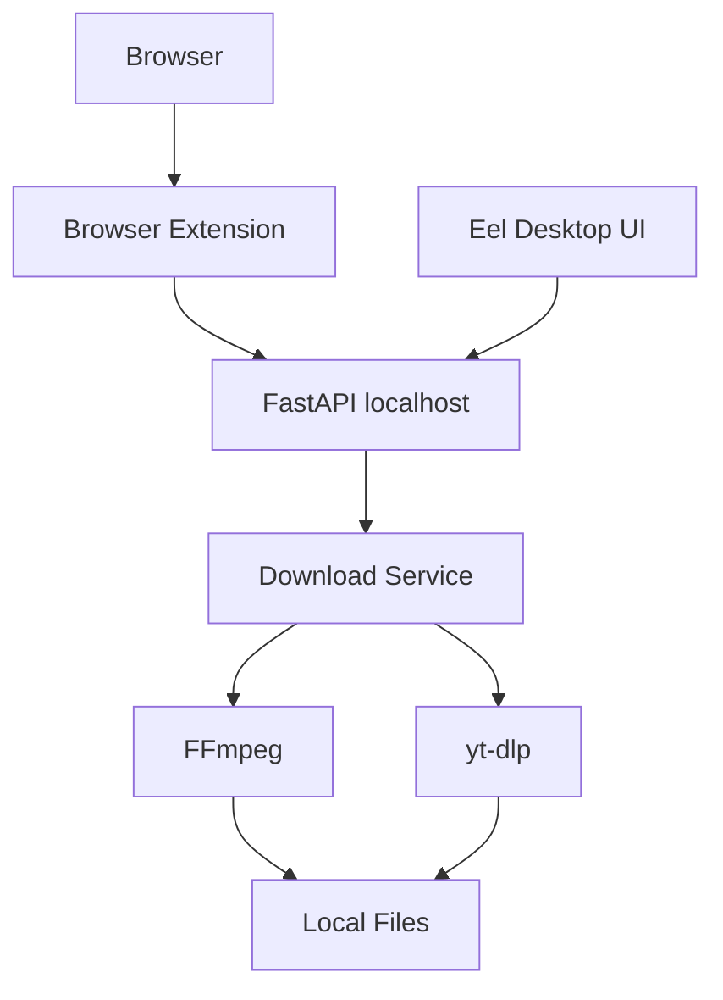

# Video Downloader Local

Aplicación **Open Source** para **Windows** que descarga videos de forma **100 % local** usando un backend **Python** (FastAPI + Eel) y una interfaz **HTML/CSS/JavaScript** moderna (Tailwind CSS, Material Icons).

[](https://github.com/KevinGil12C/video-downloader/actions/workflows/tests.yml)
[](https://www.python.org/)
[](LICENSE)
[](#licencia)
[](https://www.microsoft.com/windows)
[](CONTRIBUTING.md)

---

## Descripción

¿Qué hace?

> Dado un enlace de video, la aplicación lo descarga localmente. Puedes elegir calidad, formato (video o audio), y ver el progreso en tiempo real. También puedes cancelar descargas activas y consultar el historial.

¿Cómo funciona?

- **Modo Desktop**: la interfaz web se ejecuta dentro de una ventana nativa mediante **Eel**.
- **Modo Browser**: una **extensión de navegador** (Chrome / Brave / Edge) envía la URL de la página actual al servidor **FastAPI** de `localhost`.

En ambos casos el trabajo lo hace el backend local de Python usando **yt-dlp** (extracción) y **FFmpeg** (mezcla/conversión).

¿Por qué existe?

- La mayoría de descargadores "gratuitos" son webs remotas o cajas negras con publicidad y límites.
- Este proyecto es **transparente**, **auditable** y **privado**: todo el procesamiento ocurre en tu máquina.

### Arquitectura local y privacidad

```
Browser ──▶ Extension ──▶ localhost:8000 (FastAPI) ──▶ yt-dlp / FFmpeg ──▶ Archivos locales
Eel (Desktop UI) ───────▶ localhost:8000 (FastAPI) ──▶ yt-dlp / FFmpeg ──▶ Archivos locales
```

- 🏠 **Todo se procesa localmente.** No hay servidores remotos involucrados en las descargas.
- 🔒 **Tus archivos descargados no se suben a ningún lado.**
- 👤 **No necesitas cuenta** para usar la aplicación localmente.
- 🍪 **No se almacenan credenciales** de servicios externos. No se pide ni guarda cookies ni tokens.
- ❌ Si en el futuro se añade telemetría, será **opt-in** y estará documentada.

---

## Características

```
✓ Backend Python 100 % local
✓ Eel Desktop UI (ventana nativa Chromium)
✓ FastAPI localhost API
✓ Browser Extension (Chrome / Brave / Edge)
✓ yt-dlp (motor de extracción y descarga)
✓ FFmpeg (mezcla y conversión)
✓ Descargas locales
✓ Progreso en tiempo real (WebSocket/SSE)
✓ Cancelación de descargas
✓ Historial de descargas
✓ Mobile First UI
✓ Open Source (MIT License)
```

---

## Arquitectura



Detalle de cada componente en [docs/architecture.md](docs/architecture.md).

---

## Requisitos previos

| Requisito | Versión | Nota |
|-----------|---------|------|
| Windows | 10 / 11 | |
| Python | 3.10 o superior | marcar *Add Python to PATH* durante la instalación |
| FFmpeg | 6.x o superior | binario en `PATH` o en la carpeta `bin/ffmpeg/` |
| Git | 2.x | solo necesario para clonar |

---

## Instalación rápida

```bat
git clone https://github.com/KevinGil12C/video-downloader.git
cd video-downloader
scripts\install.bat
scripts\start.bat
```

1. **`git clone`** — descarga el código del repositorio.
2. **`cd video-downloader`** — entra en la carpeta del proyecto.
3. **`scripts\install.bat`** — crea un entorno virtual (`.venv`), instala las dependencias y verifica FFmpeg.
4. **`scripts\start.bat`** — arranca la aplicación (modo Desktop) o el servidor localhost.

> Los scripts `scripts/install.bat` y `scripts/start.bat` se implementan en la **Fase 2** del proyecto.

---

## Desarrollo

### Preparar el entorno

```bat
git clone https://github.com/KevinGil12C/video-downloader.git
cd video-downloader

python -m venv venv
venv\Scripts\activate

pip install -r requirements.txt
pip install -r requirements-dev.txt
```

### Tests, lint y formato

```bat
pytest
ruff check .
ruff format --check .
mypy app
```

Los tests **no realizan descargas reales** de contenido externo: usan mocks. Ver [docs/development.md](docs/development.md).

---

## Documentación

| Documento | Contenido |
|-----------|-----------|
| [docs/architecture.md](docs/architecture.md) | Componentes y flujo de datos |
| [docs/development.md](docs/development.md) | Entorno de desarrollo, tests y lint |
| [docs/api.md](docs/api.md) | Endpoints del API localhost |
| [docs/browser-extension.md](docs/browser-extension.md) | Instalación y uso de la extensión (Chrome/Brave/Edge) |
| [docs/security.md](docs/security.md) | Modelo de seguridad |
| [docs/troubleshooting.md](docs/troubleshooting.md) | Errores comunes y soluciones |

---

## Extensión de navegador

La extensión (carpeta [extension/](extension/)) permite descargar el video de la pestaña activa:

- **Chrome / Brave / Edge**: instalar en modo desarrollador → *Load unpacked* → seleccionar `extension/`.
- Permisos **mínimos**: solo los necesarios para leer la URL de la pestaña activa y comunicarse con `localhost`.
- **Brave**: no es necesario desactivar Shields. El flujo usa permisos de la extensión + API localhost + CORS correcto. Nunca uses `--disable-web-security`.

Guía completa en [docs/browser-extension.md](docs/browser-extension.md).

---

## Seguridad

- La API escucha únicamente en `127.0.0.1` (no expuesta a la red local ni a Internet).
- CORS restringido a orígenes locales y extensiones registradas.
- Validación estricta de URLs de entrada.
- Sin cookies, tokens ni credenciales almacenadas.
- Reportes de seguridad → [SECURITY.md](SECURITY.md).

Se mantienen habilitadas las funciones de seguridad de GitHub:

- **Dependabot** (alertas y PRs de dependencias) → [.github/dependabot.yml](.github/dependabot.yml)
- **Secret scanning** y **push protection** (detectan secretos).
- **Code scanning** (análisis estático sobre el código).

---

## Legal y uso responsable

- El usuario es responsable de utilizar esta herramienta **legalmente**.
- Deben respetarse los **derechos de autor** y los **términos de servicio** de cada plataforma.
- Descarga **únicamente** contenido que tengas derecho a descargar o que el proveedor permita descargar (por ejemplo: tus propios videos, contenido con licencia libre, o contenido que la plataforma ofrezca explícitamente para descarga).
- Este software **no** implementa mecanismos para evadir **DRM**.
- Este software **no** implementa mecanismos para saltarse **controles de acceso**.
- El proyecto está sujeto a la exención de responsabilidad de la licencia MIT (sin garantías).

---

## Contribuye

¿Quieres contribuir? 

1. Lee [CONTRIBUTING.md](CONTRIBUTING.md).
2. Lee [CODE_OF_CONDUCT.md](CODE_OF_CONDUCT.md).
3. Fork → branch → commit (Conventional Commits) → Pull Request.

```
fork → clone → install → develop → test → commit → push → pull request
```

---

## Autor

**Kevin Jesús Coyote Gil**

- Email: developer@kevscl.com
- Website: https://kevscl.com
- GitHub: https://github.com/KevinGil12C

---

## Built with

- [Python](https://www.python.org/)
- [FastAPI](https://fastapi.tiangolo.com/)
- [Eel](https://github.com/python-eel/Eel)
- [yt-dlp](https://github.com/yt-dlp/yt-dlp)
- [FFmpeg](https://ffmpeg.org/)
- [Tailwind CSS](https://tailwindcss.com/)
- [Material Icons](https://fonts.google.com/icons)

> Todas las marcas y componentes de terceros pertenecen a sus respectivos autores. Ver [THIRD-PARTY-NOTICES.md](THIRD-PARTY-NOTICES.md) (pendiente en fases posteriores) para las licencias de dependencias.

---

## Licencia

Distribuido bajo la **MIT License**. Ver [LICENSE](LICENSE).

**¿Por qué MIT?**

- Permite uso comercial y privado, modificación, distribución y sublicencia.
- Solo exige mantener el aviso de copyright y el texto de la licencia.
- No copyleft: puedes incorporar el código en proyectos propietarios sin reutilizar la licencia.
- El código se entrega "donde está" (AS IS), sin garantías, conforme a la exención de responsabilidad del MIT.

---

## Changelog

Ver [CHANGELOG.md](CHANGELOG.md).

## Soporte

¿Dudas o problemas? Ver [SUPPORT.md](SUPPORT.md).